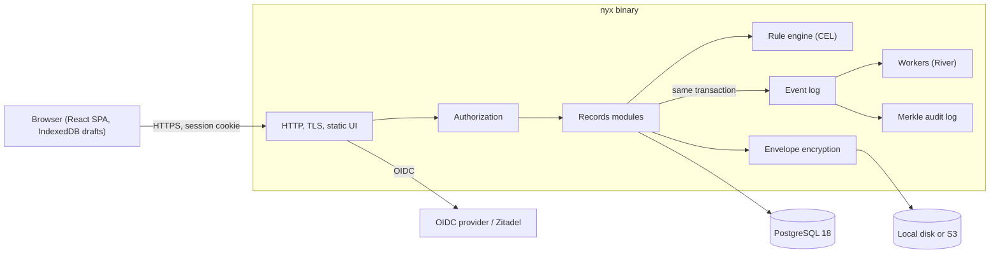

# nyxops

The NyxOps monorepo: architecture, specifications, brand assets, and (from phase 0 on) all code for NyxOps, the open source records management system (RMS) for law enforcement agencies. Read this file before contributing.

| Path | Contents |
| --- | --- |
| `nyx-project-specs/NyxOps_Architecture.md` | The architecture specification. It's the source of truth whenever this README and the spec disagree. |
| `nyx-logo-primary/` | Logo source (`.ai`) and PNG |
| `archive/` | Superseded documents, kept for history. Don't build from them. |
| `CLAUDE.md` | Instructions for AI coding agents |

## Project status

The original Python and Next.js scaffold repos (`nyx-api`, `nyx-web`, `nyx-infra`, `nyx-worker`) were deleted on 2026-11-23. This repo, formerly `nyx-design`, is now the monorepo; Go code arrives in phase 0 using the layout below. Section 2 of the spec lists the scaffold defects the port must not repeat.

## Architecture

One Go binary, `nyx`, serves the REST API, the React web interface, and background workers. PostgreSQL 18 is the only stateful core service: it stores records, the River job queue, sessions, search indexes, and the audit log.



`nyx` subcommands: `serve`, `worker`, `migrate`, `backup`, `restore`, `verify-audit`, `init`.

### Stack

| Layer | Choice |
| --- | --- |
| Language | Go, built with `CGO_ENABLED=0` and `GOFIPS140` |
| HTTP | `net/http`, spec-first OpenAPI, handlers generated by `oapi-codegen` |
| Database | PostgreSQL 18, `pgx` v5, queries generated by `sqlc`, UUIDv7 keys |
| Migrations | In-house runner over embedded SQL files |
| Jobs | River |
| Sign-in | Any OIDC provider through `go-oidc`; Zitadel bundled |
| Rules and policies | `cel-go` |
| Search | PostgreSQL full-text search, `pg_trgm`, `fuzzystrmatch` |
| Files | In-house store with local-disk and S3 backends |
| PDF output | Typst, run as a sandboxed process |
| Frontend | React, Vite, TypeScript, TanStack Router and Query, shadcn/ui, Tailwind CSS |
| Observability | `log/slog`, Prometheus text metrics, optional OpenTelemetry tracing |

The production binary has six direct dependencies: `pgx`, River, `go-oidc`, `cel-go`, `golang.org/x/crypto`, and `golang.org/x/mod`.

### Monorepo layout

```
cmd/nyx/              entry point and subcommands
internal/
  api/                generated server interfaces and handlers
  authz/              policy engine and policy-to-SQL compiler
  audit/              Merkle log, checkpoints, verification
  events/             event log and consumers
  crypto/             envelope encryption, key sources
  files/              evidence store and backends
  mpi/                master person index and matching
  nibrs/              rule packs, validation, XML export
  records/            incidents, persons, arrests, evidence, warrants
db/
  migrations/         SQL migrations, including generated RLS policies
  queries/            sqlc query files
rules/                NIBRS and state rule packs (JSON)
web/                  React frontend
deploy/compose/       small-agency Docker Compose profile
deploy/helm/          Kubernetes chart
docs/decisions/       architecture decision records
```

## Subsystems built in-house

| Subsystem | Summary | Spec section |
| --- | --- | --- |
| Event log | Every domain change writes an event in the same transaction; consumers read up to the `pg_snapshot_xmin` watermark | 7.1 |
| Authorization | One CEL policy set, checked in the API and compiled into PostgreSQL RLS policies; differential tests keep the two in agreement | 7.2 |
| Audit log | RFC 6962 Merkle log with signed checkpoints cosigned by agency-chosen witnesses | 7.3 |
| Crypto-shredding | Per-record-group data keys; destroying a key expunges the record from backups once the 30-day key-store backup window passes | 7.4 |
| Master person index | Fellegi-Sunter matching with phonetic comparators; merges go through review and can be reversed | 7.5 |
| Evidence store | Content-addressed by SHA-256, encrypted before storage, legal holds enforced | 7.6 |
| NIBRS | Rule packs in JSON drive validation, forms, and XML export | 7.7 |
| Offline drafts | IndexedDB drafts encrypted with a WebCrypto key; the server copy wins on submit | 7.8 |

## Dependency policy

Apply these rules in order to any new dependency; the first rule that matches decides.

1. Build core RMS logic (authorization, audit, NIBRS, person records, retention) in-house.
2. Adopt mature implementations for anything a security standard governs: cryptographic primitives, TLS, identity providers, password and MFA storage.
3. Build small, fully specified pieces yourself.
4. Adopt build-time tools freely, with pinned versions.
5. Put single-vendor projects with a history of license changes behind a NyxOps interface.

A new runtime dependency needs a decision record in `docs/decisions/` that names the rule applied, the license, the transitive dependency count, and the exit plan. NyxOps links only permissive or MPL-2.0 code; GPL, LGPL, and AGPL code can run only as a separate process.

## Security rules for every change

- The application database role has neither superuser nor `BYPASSRLS`. Every tenant table uses `FORCE ROW LEVEL SECURITY`.
- Set tenant context with `set_config('app.agency_id', $1, true)` inside the request transaction, never with a session-level `SET`.
- Write domain changes and their events in one transaction.
- Never update or delete audit rows; the application role lacks those privileges.
- Keep CJI values out of event payloads, logs, and metrics; store them only in encrypted columns.
- Store timestamps as `timestamptz`.
- Don't claim FIPS 140-3 validation in docs or releases until a CMVP certificate covers the shipped Go version.

CI runs `govulncheck`, `golangci-lint` with `gosec`, `go test -race`, and Playwright end-to-end tests. Releases include an SBOM from `syft`, `cosign` signatures, and SLSA provenance.

## Roadmap

| Phase | Focus |
| --- | --- |
| 0 | Monorepo, migrations, HTTP layer, OIDC sign-in, sessions, CI and signed releases |
| 1 | Event log, Merkle audit log, policy-to-RLS compiler, envelope encryption |
| 2 | Incident module as the first full feature |
| 3 | NIBRS rule engine, forms engine, XML export |
| 4 | Master person index, evidence store, chain of custody |
| 5 | Crypto-shredding, retention, legal holds, backup and restore |
| 6 | Offline drafts, AI assistance |

The spec lists exit criteria for each phase.

## Contributing

Sign off every commit (`git commit -s`) to certify the [Developer Certificate of Origin](https://developercertificate.org/). Propose architecture changes as a decision record and update the spec's decision log.

## License

Apache-2.0. See `LICENSE`.
