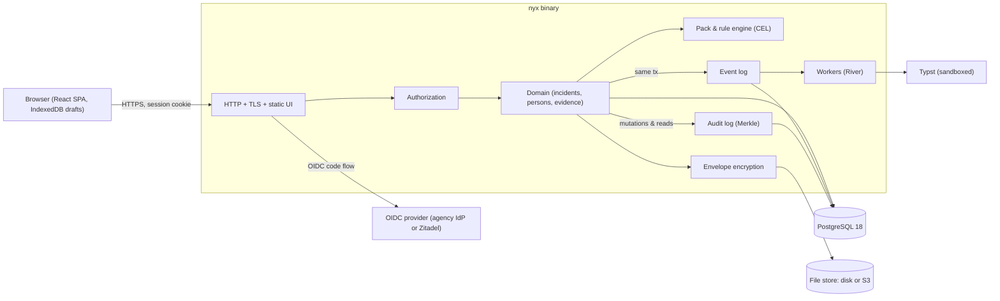

# NyxOps architecture and dependency strategy

| | |
| --- | --- |
| Status | Accepted |
| Version | 1.3 |
| Date | 2026-11-24 |
| Scope | Backend, frontend, data, security, deployment, and dependency policy |

## 1. Summary

NyxOps is a single Go binary serving an OpenAPI REST API, an embedded mobile-first React SPA, and background workers, backed by PostgreSQL as the only stateful core service.

NyxOps builds core RMS capabilities in-house: authorization, tamper-evident audit logging, pluggable crime-reporting packs (UNODC ICCS, FBI NIBRS, and national/state overlays), locale-aware person matching, retention/expungement, and the transactional event log. It adopts external implementations for hard security standards (cryptography, TLS, OIDC) and non-RMS infrastructure (database, object storage, PDF typesetting).

Design goals, in priority order:

1. **Security:** Meet the FBI CJIS Security Policy as a universal baseline with tamper-evident evidentiary integrity.
2. **Operability:** Run on modest local hardware and constrained networks, operable by one part-time IT person.
3. **Speed:** Sub-50 ms server time for normal record reads and writes.
4. **Longevity:** Maintainable for 10+ years by a small team as a vendor-neutral Digital Public Good.

## 2. Database conventions

- UUIDv7 primary keys; agency-scoped unique constraints include `agency_id`.
- `timestamptz` for timestamps; `tstzrange` for approximate windows.
- `set_config('app.agency_id', $1, true)` inside every request transaction (never session-level `SET`).

## 3. Backend

Single Go 1.24+ binary (`nyx`), built with `CGO_ENABLED=0` and `GOFIPS140`, using the standard library for HTTP, TLS, crypto, JSON, logging, and tests. Subcommands: `init`, `serve`, `worker`, `migrate`, `backup`, `restore`, `verify-audit`.

Embed the built frontend (`web/dist`), SQL migrations (`db/migrations`), and base reporting packs (`packs/`) with `//go:embed`. Load national, regional, or state overlay packs from a runtime directory without rebuilding.

## 4. Dependency policy

Evaluate every proposed dependency in order; the first matching rule decides:

1. **Core RMS domain logic** (authorization, audit, reporting packs, person matching, retention): build it.
2. **Hard security standards** (cryptography, TLS, OIDC, password/MFA storage): adopt a mature implementation.
3. **Small, fully specified utilities** (migration runner, Prometheus text metrics, minimal S3 client): build it.
4. **Build-time only tools** (`sqlc`, `oapi-codegen`, Vite, linters): adopt freely and pin versions.
5. **Single-vendor projects with license-change risk:** wrap behind a NyxOps interface.

Any production runtime dependency requires an ADR in `docs/decisions/` stating the rule applied, license, transitive dependency count, and exit plan.

## 5. Stack and runtime dependencies

| Layer | Choice | Notes |
| --- | --- | --- |
| Database | PostgreSQL 18, `pgx` v5, `sqlc` | No ORM; embedded SQL migrations with advisory lock |
| HTTP / API | `net/http`, OpenAPI (`/api/v1`), `oapi-codegen` | `ETag` concurrency, cursor pagination, RFC 9457 errors |
| Jobs | River (behind interface, D-009) | Runs in-process for small sites or as separate `worker` replicas |
| Identity & sessions | Any OIDC provider (Zitadel bundled, D-007) | BFF pattern; Postgres sessions; `HttpOnly`, `SameSite=Strict` cookies |
| Rules & policies | `cel-go` | Drives authorization (Section 7.2) and reporting packs (Section 7.7) |
| Object storage | Local disk (default) or S3-compatible (Garage default) | Minimal in-house SigV4 S3 client |
| PDF output | Sandboxed static Typst CLI | Tmpfs scratch, no network; Unicode and RTL templates |
| Frontend | React, TanStack Router/Query, Radix, shadcn/ui, Vite, Tailwind | Mobile-first, i18n/RTL, low-bandwidth |
| Observability | `/metrics` (Prometheus text), `log/slog` | Optional OpenTelemetry behind a build tag (requires ADR) |

Production Go binary direct dependencies (7 total; `go-jose` is transitive via `go-oidc`):

| Module | License | Purpose |
| --- | --- | --- |
| `github.com/jackc/pgx/v5` | MIT | PostgreSQL driver and pool |
| `github.com/riverqueue/river` | MPL-2.0 | Job execution |
| `github.com/coreos/go-oidc/v3` | Apache-2.0 | OIDC verification |
| `golang.org/x/oauth2` | BSD-3-Clause | OAuth2 auth code + PKCE |
| `github.com/google/cel-go` | Apache-2.0 | Policy and pack expressions |
| `golang.org/x/crypto` | BSD-3-Clause | ACME TLS certificates |
| `golang.org/x/mod` | BSD-3-Clause | Merkle transparency log math and signed notes |

## 6. Target architecture



## 7. Core subsystems

### 7.1 Transactional event log and search

Every domain mutation writes to `events(id uuid, agency_id, aggregate_type, aggregate_id, event_type, payload jsonb, actor_id, xact_id xid8, recorded_at)` in the same transaction. Consumers (reporting aggregators, notifications, sync) read rows with `xact_id < pg_snapshot_xmin(pg_current_snapshot())` ordered by `(xact_id, id)` and commit cursor updates atomically with effects. Payloads hold IDs and changed field names only—no CJI values. Read disclosures go to `audit_events`, never `events`.

Initial search supports agency/ID lookup, workflow status, and per-agency HMAC blind indexes for exact identifiers. Sensitive fields (narratives, names, DOBs) stay encrypted; enabling any plaintext FTS, trigram, or phonetic index requires a per-field privacy ADR (D-014).

### 7.2 Dual-layer authorization (CEL + PostgreSQL RLS)

Policies are written once in a restricted CEL subset over subject attributes (agency, roles, assignments) and record attributes (agency, sensitivity labels, case team) and enforced twice: in the API and via generated PostgreSQL `CREATE POLICY` migrations.

- Every tenant table enforces `FORCE ROW LEVEL SECURITY` under a non-superuser role without `BYPASSRLS`.
- Cross-agency sharing uses explicit `record_shares` and `agency_agreements` tables compiled into read-scoped `EXISTS (...)` predicates.
- Background workers iterate per agency and set `app.agency_id` per transaction; global system tables (`river_*`, audit checkpoints, agency registry) have no RLS.
- Sensitive lookups require a stated purpose recorded in `audit_events`; break-glass access notifies a supervisor.
- Differential tests verify API decisions match database RLS decisions.
- OIDC sign-in uses PKCE S256, verifies `amr`/`acr` MFA claims when configured, resolves to an explicitly provisioned agency membership (checked on every request), and revokes sessions on removal. `nyx init` bootstraps the first agency and admin.

### 7.3 Tamper-evident audit log

Every mutation writes to `events` and `audit_events` in one transaction. Sensitive reads, searches, exports, and downloads commit an `audit_events` row (actor, agency, operation, record IDs, outcome, purpose—no search text or field values) *before* returning data; a failed audit write blocks disclosure.

- An async worker hashes `audit_events` into an RFC 6962 Merkle tree (`golang.org/x/mod/sumdb/tlog`) and signs periodic Ed25519 checkpoints (signed-note format) using an external signing key.
- Agencies may publish checkpoints and configure independent witnesses (courts, auditors, ombudsmen) to cosign them; NyxOps requires no shared witness network (D-012).
- `nyx verify-audit` verifies inclusion, consistency across archived partitions, and witness cosignatures.
- The application DB role has no `UPDATE` or `DELETE` on audit tables; `pgaudit` logs direct DB access.

### 7.4 Envelope encryption and crypto-shredding

Each top-level record (person, incident) has its own AES-GCM data encryption key (DEK) wrapped by the agency's key-encryption key (KEK). Join rows store only opaque UUIDs and non-PII role codes so expunging a person destroys their DEK without affecting linked incidents.

- Wrapped DEKs live behind a `KeyStore` interface, separate from main backups, with a fixed 30-day backup expiry (D-011): a dedicated local volume in Docker Compose, or a separate key-store PostgreSQL/KMS instance in Helm.
- An independently durable, append-only destruction register records destroyed key IDs before deletion (after checking legal holds). Restores reconcile against this register offline and refuse to serve if freshness cannot be verified.
- KEK sources are pluggable (encrypted file, TPM, cloud KMS, Vault) and support online KEK rotation.

### 7.5 Locale-aware master person index

Person records avoid US-only identity assumptions (supporting Unicode, single names, patronymics, multiple surnames, flexible addresses/phones, and approximate or unknown DOBs). Duplicate resolution uses Fellegi-Sunter probabilistic linkage:

- Locale-pluggable normalization, transliteration, blocking keys, and comparators (script-aware distance for non-Latin scripts; phonetic encoders for Latin locales; DOB and identifier checks; alias graphs).
- Per-agency match weights estimated via expectation-maximization.
- No automatic merges: candidate pairs go to a review queue with per-field score explanations, and merges are recorded in a reversible, audited link table.

### 7.6 Evidence storage and chain of custody

- Each attachment gets an opaque storage ID and independent object per record group; its plaintext SHA-256 digest is stored in the encrypted custody record.
- Files are encrypted with the record group's DEK before leaving the process, with resumable chunked uploads for unstable links.
- Legal holds and retention schedules block deletion at the storage layer.

### 7.7 Pluggable reporting packs

Core domain tables stay independent of any national crime standard. Reporting packs (JSON, validated by JSON Schema at build time) define offense hierarchies, localized labels/messages, CEL validation rules, form visibility/requirements, and export mappings.

- Base packs for **UNODC ICCS** and **FBI NIBRS** embed in `nyx`; national penal-code or state IBR overlays load from a runtime directory.
- The API validates against active packs on save/blur, and the frontend generates localized, RTL-capable forms from the same definitions.
- Exports generate standard statistical or regulatory outputs (ICCS aggregates, NIBRS XML).

### 7.8 Offline drafts and intermittent connectivity

- Browser drafts live in IndexedDB, encrypted with a non-extractable WebCrypto key unlocked by a per-device officer PIN/passphrase (or WebAuthn PRF) and cleared on logout/shift handoff.
- Drafts use client-generated UUIDv7 IDs; server copy wins on submission and runs full validation.
- Phase 6 evaluates offline pack validation and station-to-regional intermittent sync over the event log for rural stations with multi-day outages.

### 7.9 AI assistance (later phase)

Optional, agency-controlled (self-hosted default) assistance for suggesting offense codes from the active pack, extracting entities for linking, and detecting PII for redaction. Every suggestion requires officer acceptance and is audited with model provenance. No risk scoring, predictive policing, or suspect identification.

## 8. Security baseline

- **Build & runtime:** Distroless static image, non-root user, read-only root filesystem (mounted tmpfs/`emptyDir` scratch for Typst); pin `GOFIPS140` mode and verify Ed25519 under it.
- **Transport & headers:** TLS 1.2+ everywhere (including Postgres), HSTS, CSP, CSRF checks, `Cache-Control: no-store` on CJI responses.
- **Sessions & secrets:** Per-agency idle/absolute session timeouts; no default passwords (`nyx init` generates all secrets).
- **CI & supply chain:** `govulncheck`, `golangci-lint` (`gosec`), `go test -race`, Playwright E2E, `syft` SBOM, `cosign` signatures, SLSA provenance.
- **Database:** Separate migration role; non-superuser app role without `BYPASSRLS`; `pgaudit` enabled.

## 9. Repository layout

```
nyxops/
  .github/workflows/    CI, security scans, signed releases
  api/                  OpenAPI specs (/api/v1)
  cmd/nyx/              CLI entry point and subcommands
  internal/
    api/                generated server interfaces and handlers
    auth/               OIDC login, sessions, memberships
    authz/              CEL policy engine and SQL RLS compiler
    audit/              audit_events, Merkle log, checkpoints, verification
    backup/             backup and restore orchestration
    crypto/             envelope encryption, KeyStore, KEK sources
    db/                 sqlc code, tx/RLS helpers, migrations
    events/             event log and consumers
    files/              evidence store (local disk, minimal S3)
    jobs/               job interface and River adapter
    mpi/                locale-pluggable person matching
    reporting/          reporting packs, CEL validation, ICCS/NIBRS exports
    pdf/                Typst templates (Unicode/RTL) and sandboxed runner
    records/            incidents, persons, evidence
    retention/          retention schedules, legal holds, crypto-shredding
  db/
    migrations/         SQL migrations and generated RLS policies
    queries/            sqlc query files
  policies/             CEL authorization policies
  packs/                base reporting packs (UNODC ICCS, FBI NIBRS) and i18n labels
  web/                  mobile-first, localized React SPA
  deploy/
    compose/            small-agency Docker Compose profile
    helm/               Kubernetes chart
  docs/decisions/       architecture decision records (D-014 onward)
  nyx-project-specs/    architecture specification
  nyx-logo-primary/     brand assets
```

## 10. Deployment profiles

**Small agency (Docker Compose):** Target hardware up to ~100 officers: 2 vCPU, 4 GB RAM, 100 GB SSD (to be confirmed by Phase 2 load tests).

| Container | Role | Notes |
| --- | --- | --- |
| `nyx` | API, UI, workers, TLS, sandboxed Typst | Dedicated key-store volume + tmpfs scratch |
| `postgres` | All state, jobs, sessions, audit log | Also hosts Zitadel's DB if bundled |
| `zitadel` | Identity (optional) | Omit when using an external OIDC IdP |
| `garage` | S3 storage (optional) | Omit when using local disk or existing S3 |

**Multi-replica (Helm):** Separate `serve` and `worker` replicas (Typst in worker or sidecar), managed/replicated PostgreSQL, and a dedicated key-store PostgreSQL or external KMS/Vault.

## 11. Roadmap

| Phase | Deliverables | Exit criteria |
| --- | --- | --- |
| 0. Foundations | Monorepo, migrations, HTTP/OpenAPI, OIDC sign-in, sessions, CI/release signing | Signed release installs via `nyx init`; sign-in works with Zitadel and Entra ID |
| 1. Trust core | Event log, `audit_events` + Merkle log, CEL-to-RLS compiler, envelope encryption | Differential authz tests pass; `nyx verify-audit` detects tampering |
| 2. First vertical slice | Synthetic incidents, workflow, i18n scaffolding, mobile-responsive forms | End-to-end incident creation under RLS + audit; load test meets Section 10 targets |
| 3. Reporting packs | Rule engine, UNODC ICCS and FBI NIBRS packs, localized forms, statistical/XML exports | Exports pass ICCS schema and FBI NIBRS test-file validation |
| 4. Persons and evidence | Locale-pluggable MPI, resumable encrypted evidence store, chain of custody | Precision/recall measured on a multilingual synthetic dataset |
| 5. Retention | Crypto-shredding, retention schedules, legal holds, backup/restore | Restore drill recovers records/attachments, honors holds, keeps expunged records unreadable |
| 6. Field, sync, and AI | Offline drafts, offline pack validation, station-to-regional sync, AI assistance | Pilot with one agency |

**Pilot readiness and deferred scope:** The first real-data pilot follows Phase 5 after passing a restore drill, audit-failure tests, tenant-isolation tests, and hold verification on the target profile. Detention/custody logs, arrests, warrants, and vehicle records are deferred (with detention/custody prioritized for justice-sector deployments). NCIC integration remains optional and US-specific.

## 12. Licensing

NyxOps is licensed under **Apache-2.0** with DCO sign-off (`git commit -s`). All linked Go and frontend dependencies use permissive licenses (MIT, Apache-2.0, BSD-3-Clause) or file-level copyleft (River: MPL-2.0). AGPL-3.0 services (Zitadel, Garage) and PostgreSQL/Typst run as separate, unmodified processes and are not linked into `nyx`.

## 13. Decision log

| ID | Decision | Status |
| --- | --- | --- |
| D-001 | Go for backend and workers | Accepted |
| D-002 | PostgreSQL 18 as the only stateful core service | Accepted |
| D-003 | PostgreSQL for jobs and search; local disk or S3 for files | Accepted |
| D-004 | REST with spec-first OpenAPI | Accepted |
| D-005 | Static React SPA served by the Go binary | Accepted |
| D-006 | Build authorization, audit, event log, NIBRS, person matching, evidence store, and retention in-house | Accepted |
| D-007 | Any OIDC provider; bundle Zitadel for agencies without one | Accepted |
| D-008 | Single monorepo | Accepted |
| D-009 | River for job execution | Accepted |
| D-010 | No FIPS validation claim without a CMVP certificate covering the shipped Go version | Accepted |
| D-011 | 30-day retention window for key-store backups | Accepted |
| D-012 | Audit checkpoints cosigned by agency-chosen witnesses only | Accepted |
| D-013 | Apache-2.0 for all NyxOps code; contributions under DCO | Accepted |
| D-014 | [Record access, storage and pilot readiness](../docs/decisions/0014-record-lifecycle.md) | Accepted |
| D-015 | [Operational seams, key boundaries, and repository layout](../docs/decisions/0015-operational-seams.md) | Accepted |
| D-016 | [International and low-resource readiness](../docs/decisions/0016-international-and-low-resource-readiness.md) | Accepted |
