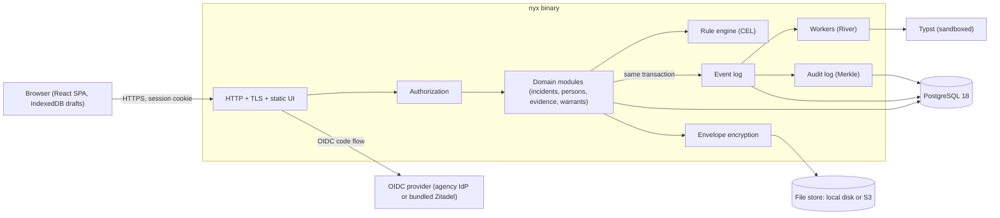

# NyxOps architecture and dependency strategy

| | |
| --- | --- |
| Status | Accepted |
| Version | 1.1 |
| Date | 2026-11-24 |
| Scope | Backend, frontend, data, security, deployment, and the policy for what NyxOps builds versus what it depends on |

## 1. Summary

NyxOps uses a Go backend shipped as a single binary, a static React frontend, and PostgreSQL as the one stateful system that handles records, jobs, search, sessions, and the audit log. A small agency runs the deployment profile in section 10.

NyxOps builds in-house the core records management features: authorization, the audit log, NIBRS validation, person matching, retention and expungement, and the event log that ties them together. It depends on outside projects for anything governed by a hard security standard (cryptography, TLS, OpenID Connect sign-in) and for anything whose difficulty lies outside the RMS domain (the database engine, object storage engines, typesetting).

The design goals, in priority order when they conflict:

1. Secure enough to hold Criminal Justice Information (CJI) under the FBI CJIS Security Policy.
2. Operable by an agency with one part-time IT person.
3. Fast: sub-50 ms server time for normal record reads and writes on modest hardware.
4. Maintainable for 10 or more years by a small open source team.

## 2. Database conventions

Use UUIDv7 primary keys. Scope report numbers and other agency-specific unique constraints by agency ID. Store occurrence and report times as `timestamptz` and approximate occurrence windows as `tstzrange`. Set tenant context with `set_config('app.agency_id', $1, true)` inside each request transaction.

## 3. Backend

The API and workers share one Go binary. Use the standard library for HTTP, TLS, cryptography, JSON, logging and tests. Pin dependency versions and deployment images.

## 4. Dependency policy

Every proposed dependency goes through these rules in order. The first rule that applies decides.

1. Core RMS domain logic (authorization, audit, NIBRS, person records, retention): build it. No library models law enforcement records well, and these features are the reason NyxOps exists.
2. Security-critical work governed by a hard standard (cryptographic primitives, TLS, OIDC provider, password and MFA storage): adopt a mature implementation. Writing these in-house adds risk and no value.
3. Small, fully specified work (a migration runner, Prometheus text output, S3 request signing): build it. A few hundred owned lines beat an unowned dependency tree.
4. Build-time only tools (code generators, bundlers, linters): adopt freely, pin versions, and review upgrades. They never execute in production.
5. Single-vendor projects with a history of license changes: use them only behind a NyxOps interface so an agency can swap them.

Any runtime dependency, whether adopted or replacing a built component, needs a short decision record in `docs/decisions/` stating which rule applied, the license, the transitive dependency count, and the exit plan.

## 5. Build and adopt decisions

| Component | Decision | Implementation |
| --- | --- | --- |
| Database engine | Adopt | PostgreSQL 18 |
| Database driver | Adopt | `pgx` v5 |
| Query layer | Adopt (build time) | `sqlc` |
| Migrations | Build | Embedded SQL files, advisory lock, version table and reviewable SQL policies |
| HTTP and API | Build | `net/http` routing, spec-first OpenAPI file, `oapi-codegen` (build time) |
| Job execution | Adopt behind interface | River (D-009) |
| Event log and outbox | Build | Section 7.1 |
| Identity provider | Adopt, swappable | Any OIDC provider; Zitadel bundled for agencies without one (D-007) |
| Token verification | Adopt | `go-oidc`, `go-jose` |
| Browser sessions | Build | Backend-for-frontend; sessions in Postgres; HttpOnly, SameSite=Strict cookies |
| Authorization | Build | Section 7.2 |
| Audit log | Build | Section 7.3, Merkle math from `golang.org/x/mod/sumdb/tlog` |
| Cryptographic primitives | Adopt | Go standard library in FIPS mode |
| Envelope encryption and key handling | Build | AES-GCM and HKDF from the standard library; pluggable key-encryption-key source |
| Object storage engine | Adopt, optional | Any S3-compatible service; Garage as the self-hosted default |
| Evidence and file store | Build | Section 7.6, with local-disk and minimal S3 backends |
| Search | Build | Approved fields only (section 7.1), PostgreSQL full-text search, `pg_trgm`, `fuzzystrmatch` |
| Person matching | Build | Section 7.5 |
| NIBRS validation and export | Build | Section 7.7 |
| Rule expressions | Adopt | `cel-go` |
| Forms | Build | Generated from the rule definitions (section 7.7) |
| Offline drafts | Build | Section 7.8 |
| PDF output | Adopt | Typst CLI in a sandboxed worker process |
| TLS termination | Build | `golang.org/x/crypto/acme/autocert` or agency-supplied certificates |
| Metrics and logs | Build | `/metrics` in Prometheus text format; `log/slog`, optional tracing behind a build tag |
| Backup and restore | Build | `nyx backup` wrapping `pg_basebackup` and the file store, separate key backups and scheduled restore tests |
| Frontend runtime | Adopt | React, TanStack Router, TanStack Query, Radix primitives |
| Frontend build | Adopt (build time) | Vite, TypeScript, Tailwind CSS |
| UI components | Own | shadcn/ui copied into the repo |

### Runtime dependency inventory

The production Go binary carries six direct dependencies:

| Module | License | Purpose |
| --- | --- | --- |
| `github.com/jackc/pgx/v5` | MIT | PostgreSQL driver and pool |
| `github.com/riverqueue/river` | MPL-2.0 | Job execution |
| `github.com/coreos/go-oidc/v3` | Apache-2.0 | OIDC client and token verification |
| `github.com/google/cel-go` | Apache-2.0 | Policy and validation expressions |
| `golang.org/x/crypto` | BSD-3-Clause | ACME certificates |
| `golang.org/x/mod` | BSD-3-Clause | Transparency log math and signed notes |

Zitadel (AGPL-3.0), Garage (AGPL-3.0), Typst (Apache-2.0), and PostgreSQL (PostgreSQL License) run as separate processes and NyxOps doesn't link them, so they don't constrain the NyxOps license choice. Section 12 covers the license decision.

## 6. Target architecture



The `nyx` binary has subcommands `init`, `serve`, `worker`, `migrate`, `backup`, `restore`, and `verify-audit`. Small deployments run `serve` with workers in-process; larger ones run separate `worker` replicas.

## 7. Core subsystems

### 7.1 Event log ties every downstream feature to one transactional stream

Every domain change writes an event row in the same transaction as the data change. Consumers (audit log, search indexer, NIBRS aggregator, notifications, offline sync, future inter-agency sharing) read the stream; consumers that need current values fetch them through the authorized domain read path.

- Schema: `events(id uuid, agency_id, aggregate_type, aggregate_id, event_type, payload jsonb, actor_id, xact_id xid8, recorded_at)`.
- Ordering: a `bigserial` cursor isn't safe because a transaction that commits late can insert a lower sequence number after a consumer has moved past it. Within a single snapshot, read rows with `xact_id < pg_snapshot_xmin(pg_current_snapshot())` in ascending `(xact_id, id)` order, starting strictly after the last saved pair. Commit database effects and the consumer cursor together. Queue external deliveries in that transaction and deduplicate retries by event ID at the destination. Test a transaction split across batches, a delayed commit and a worker restart.
- Payloads carry identifiers and changed field names; sensitive field values stay in the encrypted domain tables so crypto-shredding (section 7.4) reaches them.

Phase 2 supports exact lookup by agency and opaque incident ID. Workflow status may be indexed inside the agency. Narratives, names, dates of birth and identifiers stay encrypted. Full-text terms, trigrams, phonetic codes and identifier fragments can disclose source values. Before enabling each additional search or matching field, document its source, stored derivatives, permitted readers and removal from live data and backups. Phase 4 matching initially computes sensitive comparisons in memory on authorized agency records.

### 7.2 One policy definition drives both API checks and PostgreSQL RLS

Access rules are written once and enforced twice: by the API before it runs a query, and by PostgreSQL Row-Level Security on every row the query touches. A bug in either layer alone doesn't expose records.

Rules cover:

- Agency tenancy and multi-agency sharing agreements.
- Role and assignment: case team members, supervisors, records staff.
- Sensitivity labels: sealed, juvenile, confidential informant, CJI versus non-CJI.
- Reason for access: sensitive lookups require a stated purpose, which goes into the audit log; break-glass access notifies a supervisor.

Policies use a restricted CEL subset over subject attributes (roles, assignments, agency) and record attributes (agency, labels, case team). A compiler translates each policy into a SQL predicate for `CREATE POLICY` statements in a generated migration. The application role isn't a superuser, every tenant table uses `FORCE ROW LEVEL SECURITY`, and the request transaction sets context with `set_config(..., true)`.

Differential tests generate random subjects and records and assert the API decision equals the database decision.

Phase 0 uses a short-lived, single-use OIDC login transaction with state, nonce and PKCE S256. Bind it to the initiating browser with a Secure, HttpOnly, SameSite=Lax correlation cookie for the top-level GET callback. Verify the transaction and tokens before issuing the Strict session cookie. Resolve the verified issuer and subject to an explicitly provisioned agency membership. Check current membership on every request and revoke affected sessions on removal. Exercise the callback with an identity provider on another site.

### 7.3 The audit log is tamper-evident and verifiable by outside parties

Every record access and change appends an entry to a Merkle tree log using the Certificate Transparency construction (RFC 6962), with tree math from `golang.org/x/mod/sumdb/tlog`.

- Commit an append-only audit event before releasing record details, search results, exports or the first download byte. Capture the actor, agency, operation, affected record IDs, outcome and required purpose. Exclude search text and field values. A failed audit write blocks disclosure. Record mutations and their audit events atomically. The Merkle worker consumes durable events asynchronously. Test successful reads, denied access, audit storage failure and interrupted downloads. Record download authorization separately from completion.
- Leaves hold a hash of the audit event; the event itself stays in Postgres.
- At a fixed interval, NyxOps signs a checkpoint (tree size and root hash) with an Ed25519 key in the signed-note format.
- Agencies can publish checkpoints to an oversight body, a court, or a public endpoint.
- Each agency chooses its own witnesses (for example a state auditor, a court clerk, or a neighboring agency) that cosign checkpoints with their own Ed25519 keys. NyxOps doesn't run or require a shared witness network; `nyx verify-audit` checks cosignatures against the witness keys the agency configures (D-012).
- `nyx verify-audit` proves any entry is included and any later checkpoint extends an earlier one. A database administrator who edits or deletes an entry breaks the proof.

Checkpoints reveal only a size and a hash, so publishing them exposes no CJI. The database also revokes `UPDATE` and `DELETE` on audit tables from the application role, and `pgaudit` records direct database sessions.

### 7.4 Crypto-shredding makes expungement reach backups

Each record group (a person's record set, or an incident) has its own data encryption key, wrapped by the agency's key-encryption key. Sensitive columns and attached files are encrypted with the data key.

When a court orders expungement, NyxOps destroys the data key and records the destruction in the audit log. Live access ends on destruction. Historical key copies age out under the recovery policy below.

The hard part is the key table itself: if full backups contain it, old backups still hold the destroyed key. The design keeps wrapped data keys in a separate key store with its own backup stream and a fixed 30-day retention window (D-011). An expungement completes when that window passes, and the system reports the completion date to the requester.

The small-agency profile stores wrapped keys in a dedicated volume outside the PostgreSQL cluster and file-store backup set. Back up that volume separately and enforce the same 30-day expiry on every snapshot and replica backup containing keys. Keep an independently durable, append-only register of destroyed key IDs. Record the destruction intent before removing a key, deny its use immediately and retry removal after interruption. Restore offline, reconcile keys against the latest register and refuse to serve if its freshness cannot be verified. Check legal holds before authorizing destruction.

Key-encryption-key sources sit behind an interface: an encrypted file for small agencies, TPM, cloud KMS, or HashiCorp Vault.

### 7.5 The master person index resolves duplicates with explainable matching

Duplicate person records are a chronic problem in existing RMS products. NyxOps builds probabilistic record linkage using the Fellegi-Sunter model:

- Blocking keys (phonetic surname code, birth year, identifier fragments) limit candidate pairs.
- Comparators: Double Metaphone and NYSIIS for names, Jaro-Winkler distance, date-of-birth transposition and off-by-one checks, alias graphs, and exact matches on identifiers such as driver license and state ID.
- Expectation-maximization estimates match weights per agency from that agency's data.
- NyxOps never merges automatically. Pairs above an upper threshold go to a review queue with a per-field explanation of the score.
- A link table records merges instead of destructive updates, so any merge can be reversed and audited.

### 7.6 Evidence storage and chain of custody

- Assign each attachment an opaque, unique storage ID. Keep its plaintext SHA-256 digest in the encrypted custody record for integrity checks. Identical uploads in separate record groups receive independent objects and keys. Test that expunging one group preserves a held copy in another.
- Files are encrypted with the record group's data key before they leave the process.
- Legal holds and retention schedules block deletion at the storage layer.
- Backends: local disk (default for small agencies, no extra container) and a minimal S3 client implementing SigV4 signing, multipart upload, and the GET, PUT, HEAD, and DELETE calls NyxOps needs. Garage, Ceph RGW, AWS S3, and other S3-compatible services all work.

### 7.7 NIBRS rules are data, and the same rules drive forms and validation

- The FBI NIBRS technical specification error codes become rule packs: JSON files containing CEL expressions, error codes, messages, and the fields each rule reads. A JSON Schema validates pack files at build time.
- States add their IBR variations as extra packs without changing code.
- The API validates against the active packs on every save, and the frontend shows errors inline as the officer types, instead of at the month-end submission.
- The forms engine generates field visibility, required fields, and allowed values from the same definitions, so the UI and the server can't drift apart.
- Exports produce NIBRS XML from the same data model. Offline validation reuses the rule packs compiled to WebAssembly (section 7.8).

### 7.8 Offline drafts let officers write reports without a connection

Each draft belongs to one officer until submission.

- The browser stores drafts in IndexedDB, encrypted with a non-extractable WebCrypto key tied to the session.
- Drafts use client-generated UUIDv7 identifiers.
- The server copy wins on submission and runs full validation; the event log feeds draft updates back to the officer's other devices.
- CJIS rules for mobile devices still apply: agencies must manage the devices that store drafts.

### 7.9 AI assistance (later phase) runs on agency-controlled models with officer sign-off

Candidate features: suggest a NIBRS offense code from the narrative, extract persons and vehicles for linking, and detect PII for public-records redaction.

Constraints:

- The integration layer is in-house with pluggable providers; self-hosted models are the default so CJI stays inside the agency boundary.
- Every suggestion requires an officer to accept it, and the audit log records which model produced it.
- NyxOps won't build risk scoring, predictive policing, or suspect identification features.

## 8. Security baseline

- Builds: `CGO_ENABLED=0`, `GOFIPS140` set, distroless static base image, non-root user, read-only root filesystem.
- Transport: TLS 1.2 or later everywhere, including between `nyx` and PostgreSQL.
- Sessions: server-side, idle timeout and absolute lifetime set per agency to match CJIS session-lock requirements.
- Secrets: no default passwords; `nyx init` generates every secret at install.
- CI: `govulncheck`, `golangci-lint` with `gosec`, `go test -race`, Playwright end-to-end tests, Renovate for dependency updates.
- Supply chain: SBOM from `syft` attached to every release, images signed with `cosign`, SLSA build provenance from GitHub Actions.
- Database: application role without superuser or `BYPASSRLS`, separate migration role, `pgaudit` on.

## 9. Repository layout

```
nyxops/
  cmd/nyx/              entry point and subcommands
  internal/
    api/                generated server interfaces and handlers
    authz/              policy engine and SQL compiler
    audit/              Merkle log, checkpoints, verification
    events/             event log and consumers
    crypto/             envelope encryption, key sources
    files/              evidence store and backends
    mpi/                person matching
    nibrs/              rule packs, validation, XML export
    records/            incidents, persons, arrests, evidence, warrants
  db/
    migrations/         SQL migrations, including generated RLS policies
    queries/            sqlc query files
  rules/                NIBRS and state rule packs (JSON)
  web/                  React frontend
  deploy/
    compose/            small-agency Docker Compose profile
    helm/               Kubernetes chart
  docs/
    decisions/          architecture decision records
```

## 10. Deployment profiles

The small-agency profile runs these containers:

| Container | Role | Notes |
| --- | --- | --- |
| `nyx` | API, web UI, workers, TLS | Single static binary |
| `postgres` | All application state, job queue, search, sessions, audit log | Also hosts Zitadel's database |
| `zitadel` | Identity | Omitted when the agency uses its own OIDC provider |
| `garage` | Object storage | Omitted when files use local disk or existing S3 |

Target hardware for an agency of up to roughly 100 sworn officers: 2 vCPU, 4 GB RAM, 100 GB SSD. These figures are targets; load testing in phase 2 must confirm them.

Larger and multi-agency deployments use the Helm chart with separate `serve` and `worker` replicas and a managed or replicated PostgreSQL.

## 11. Roadmap

| Phase | Deliverables | Exit criteria |
| --- | --- | --- |
| 0. Foundations | Monorepo, migration runner, HTTP layer, OIDC sign-in against any provider, sessions, CI and release signing | A signed release installs with `nyx init` and a user signs in through Zitadel and Entra ID |
| 1. Trust core | Event log, Merkle audit log, policy-to-RLS compiler, envelope encryption | Differential authorization tests pass; `nyx verify-audit` detects a manually altered entry |
| 2. First vertical slice | Synthetic incident records with narratives and status workflow. Attachment handling starts in phase 4 | End-to-end incident creation under RLS with audit entries; load test confirms section 10 targets |
| 3. NIBRS | Rule engine, FBI rule pack, forms engine, XML export | Exports pass FBI test-file validation |
| 4. Persons and evidence | Master person index, evidence store, chain of custody | Matching precision and recall measured on a synthetic dataset |
| 5. Retention | Crypto-shredding, retention schedules, legal holds, backup and restore | A restore drill recovers an ordinary record and its attachment, honors holds and confirms an expunged record stays unreadable after the key backup window |
| 6. Field and AI | Offline drafts, AI assistance | Pilot with one agency |

### Product scope and pilot readiness

Phase 0 delivers an installable sign-in demonstration. Phase 2 delivers the first incident workflow for synthetic data. The first agency pilot with real records follows phase 5 and requires a successful restore drill, access-audit failure tests, tenant isolation tests and evidence hold verification on the deployment profile the agency will use. Arrest and booking, warrants and vehicle records are deferred without delivery dates. NCIC integration remains an open product decision.

## 12. Licensing

Every component NyxOps links into its own binary or ships in its frontend bundle uses a permissive or file-level copyleft license:

| Component | License | Effect on NyxOps |
| --- | --- | --- |
| `pgx`, React, TanStack, Radix, shadcn/ui, Vite, Tailwind CSS | MIT | None beyond keeping notices |
| `go-oidc`, `go-jose`, `cel-go`, TypeScript | Apache-2.0 | Keep notices; compatible with any permissive license |
| `golang.org/x/crypto`, `golang.org/x/mod`, Go standard library, `protobuf` and `antlr4` (via `cel-go`) | BSD-3-Clause | None beyond keeping notices |
| River | MPL-2.0 | Changes to River's own files stay MPL-2.0; the rest of NyxOps can use any license |
| Zitadel, Garage | AGPL-3.0 | Separate processes, not linked; NyxOps ships unmodified upstream images, so no obligation passes to NyxOps code |
| PostgreSQL, Typst | PostgreSQL License, Apache-2.0 | Separate processes |

NyxOps uses Apache-2.0. Contributors sign commits under the Developer Certificate of Origin.

## 13. Decision log

| ID | Decision | Status |
| --- | --- | --- |
| D-001 | Go for backend and workers | Accepted |
| D-002 | PostgreSQL 18 as the only stateful core service | Accepted |
| D-003 | Use PostgreSQL for jobs and search, and local disk or S3 for files | Accepted |
| D-004 | REST with spec-first OpenAPI | Accepted |
| D-005 | Static React SPA served by the Go binary | Accepted |
| D-006 | Build authorization, audit, event log, NIBRS, person matching, evidence store, and retention in-house | Accepted |
| D-007 | Any OIDC provider; bundle Zitadel for agencies without one | Accepted |
| D-008 | Maintain the project in one monorepo | Accepted |
| D-009 | River for job execution | Accepted |
| D-010 | No FIPS validation claim without a CMVP certificate covering the shipped Go version | Accepted |
| D-011 | 30-day retention window for key-store backups | Accepted |
| D-012 | Audit checkpoints cosigned by agency-chosen witnesses only | Accepted |
| D-013 | Apache-2.0 for all NyxOps code, contributions under DCO | Accepted |
| D-014 | [Record access, storage and pilot readiness](../docs/decisions/0014-record-lifecycle.md) | Accepted |
